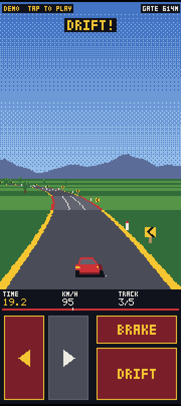
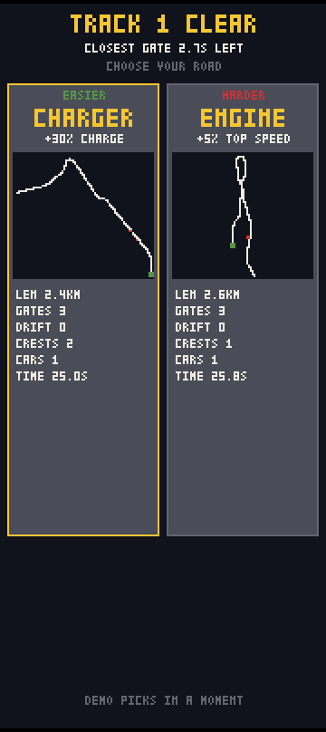
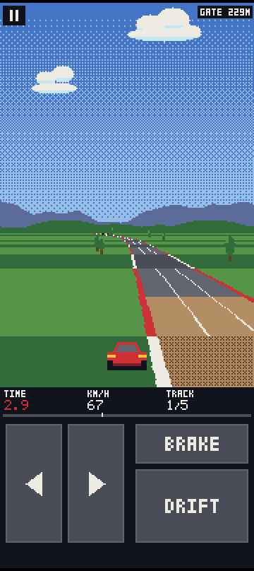

# racer

[](https://github.com/cascadiacollections/racer/actions/workflows/ci.yml?query=branch%3Amain)
[](https://github.com/cascadiacollections/racer/releases/tag/dev)
[](LICENSE)
[](project.godot)
[](rust-toolchain.toml)

<!-- Navigation badges, not live status: public badge services cannot read
this private repository. -->

A portrait, retro pseudo-3D roguelike racer in which every generated track is
**proven drivable** by a human-like bot before you see it.

"racer" is a working codename. The game has no name yet; one gets picked
after the feel slice (DESIGN §7).

| A drift corner | A fork between tracks | Gravel on the run-in |
|---|---|---|
|  |  |  |

Pixel 10 captures (dev build, DEMO and a playtest run), scaled to 2× the
game's 180-pixel-wide buffer. The art is placeholder pixel art drawn in code.

- **Play:** a run is five generated tracks of about a minute against a
  checkpoint timer. After each, the road forks: an easier track or a harder
  one, each with an upgrade that stacks. Drift through bends to charge a
  boost; from track 3 some corners need it.
- **Build:** a dependency-free Rust simulation owns every rule; Godot 4.7.2
  (through gdext) only presents it, from one software-rastered buffer.
- **Verify:** a solver drives every track with a perfect bot and a
  human-like one before it is shown; CI proves 1,800 tracks per pull request
  and compares a determinism digest across Linux, macOS, Windows and an
  Android emulator.

**Status: early prototype, milestone 2.** Playable on Android phones from the
first track to the fifth. No sound yet, placeholder art, balance moving
between builds, and not on any store. The [development build](https://github.com/cascadiacollections/racer/releases/tag/dev)
follows `main`.

[Build and run](#build-and-run) · [Controls](#controls) ·
[How tracks are proven](#how-tracks-are-proven) · [Architecture](#architecture) ·
[CI](#ci) · [Site](#site) · [Licensing](#licensing)

## Build and run

Needs Rust (the toolchain is pinned in `rust-toolchain.toml`; rustup picks it
up), Godot `4.7.2` on `PATH` as `godot`, and [`just`](https://just.systems).
The `godot` crate is built against the `api-4-7` feature; raise it together
with the engine.

```bash
just test      # unit, property, snapshot and golden-run tests; no Godot needed
just run       # build the GDExtension (debug), import, and play in a portrait window
just balance   # build and prove 1,800 tracks across 200 run seeds; exit 1 on a failed gate
just digest    # the cross-platform determinism digest
just trackviz 7 2 1      # a strip chart of run seed 7, track 2, branch 1 (--png out.png)
just lint      # clippy, warnings as errors; `just fmt` checks formatting
```

Always build before launching Godot: the editor loads the extension from
`target/`, so a stale build is what it runs.

### Device profiling

Build with `just android-apk release profiling` to log raster, process and
frame-interval means and p95s every two seconds of racing. In this build,
`--racer-profile-seed=7` starts the same automated demo on every launch.
For an Android export, temporarily set `command_line/extra_args` to that
flag in the Android preset; restore the preset after exporting. Android's
launcher does not pass arbitrary command-line extras through to the game.

Compare repeated baseline and candidate runs with the same seed, season,
track sections and power state; retain logcat, memory and thermal captures.
The log's p95 is per two-second window, not a percentile over the whole run.
The demo is silent, so profile a played race separately for audio costs.

After building and importing, `python tools/check_audio_shutdown.py` checks
that both title tunes shut down cleanly in headless Godot. Use
`--godot /path/to/godot` if the engine is not on `PATH`. This checks resource
cleanup, not audible playback. The game allows 100 ms for Godot's mixer to
release stopped voices during shutdown.

### Android

Android builds are arm64, exported through Godot's Gradle template with a
stripped engine ([docs/godot-templates.md](docs/godot-templates.md)), about
28 MB. They need the Android SDK and NDK (`ANDROID_HOME`, `ANDROID_NDK_HOME`)
and JDK 21; the Justfile always uses the SDK's `adb`.

```bash
just android-template          # once: unpack the Gradle template (+ the stripped engine)
just android                   # debug export, install and launch on the attached phone
just android release           # release export, same debug key
just android-digest            # run the determinism corpus on the phone; fail unless it matches this machine
just pull-runs                 # copy your saved runs off the phone and compare them with the bot
just screen <name>             # device screenshot to target/screens/<name>.png
just android-log               # follow the game's log
```

`just godot-template` builds the stripped engine from source;
[docs/godot-templates.md](docs/godot-templates.md) covers it and the lock that
pins it.

A CI build and a local build are signed with different keys, so going from
one to the other needs an uninstall, which deletes saved runs.

## Controls

| | Touch | Keys | Pad |
|---|---|---|---|
| Steer | `◀` `▶` pads (slide across to swap) | `←` `→` or `A` `D` | left stick or d-pad |
| Brake | `BRAKE` | `↓` or `S` | d-pad down, X, L1 or L2 |
| Drift | `DRIFT`, held with some steering | `Space` or `Shift` | A, R1 or R2 |
| Pause | the pause button, top left | `Esc` or `P` | Start or Back |

The throttle is automatic. Keys and touch pads ramp the steering to full lock
over 200 ms, so a tap is a nudge; the stick is not ramped. On a phone the pads
sit above Android's gesture area. Every device quantises to the same one byte
per tick (seven steering levels, brake, drift), so a replay cannot tell them
apart.

## How tracks are proven

Every track is proven before it is shown: not "probably drivable", but driven,
on every loadout the player can arrive with (DESIGN §2.4).

- **Two bots, one set of hands.** The *perfect* bot plans the whole track's
  speed at 93% of grip with no delay and beam-searches which corners to drift:
  the ceiling. The *human-like* bot acts on 150 ms old observations, plans no
  further than it can see over a crest, uses 85% of grip, aims a little off
  its line, lapses and overcooks the odd corner: the floor.
- **Calibrate.** Each gate's time comes from sixteen human drives on the
  weakest reachable loadout, plus a margin (2.0 s on track 1, down to 1.0 s on
  track 5).
- **Check.** The perfect bot must finish with 6–18 s left; the human must be
  8–30% slower; drift-required corners must be passable with a drift and cost
  a grip-only driver at least 1.5 s; and on every reachable loadout, 15 of 16
  fresh human drives must keep the margin at every gate.
- **Fall back.** A failing draft is redrawn (up to 8 times), then its worst
  section softened, then replaced by a gentle road every car takes flat out.

The batch gate (`just balance`, and CI) builds 1,800 tracks across 200 run
seeds and requires no unvalidated tracks, at most 2% fallbacks, and the human
bot losing 3–15% of 1,000 holdout runs. [NOTES.md](NOTES.md) has the numbers
and why each changed.

The bot's numbers are guesses until compared with real drivers: every run you
finish or quit is saved on the phone (seed plus input log), and
`just pull-runs` sets each track beside sixteen human-bot drives of it
(`playstats`).

## Architecture

```text
crates/racer-sim/     the whole game, no dependencies, no engine
  car, race, run        motion and drift, the checkpoint timer, five tracks and their forks
  track, traffic        integer segments, sight lines, closed-form traffic
  gen/, bot/, solver    grammar and overlays, the two bots, the prove-or-redraw ladder
  replay                a run as seed + input log, rebuilt and verified
  dmath, rng, hash      own trig (no libm), SplitMix64/PCG32 streams, FNV-1a
  bin/                  batch, determinism, trackviz, playstats
crates/racer-godot/   the GDExtension: one Godot node, everything else engine-free
  app, input, touch     modes, the run, pause, DEMO; bindings and the steering ramp
  project, render       the pseudo-3D road, pinned in metres; a race painted
  raster, palette, ...  one 180-px-wide RGBA buffer, 16 colours, bitmap fonts, sprites
addons/device_power/  godot-device-power, vendored: frame-rate cap from charger and heat
godot/                scenes and the platform glue
```

- **Engine-free core.** `racer-sim` builds and tests headless with no Godot
  installed; `racer-godot` keeps everything but its one node engine-free too,
  so the renderer's frames are unit-tested with `cargo test`.
- **Determinism.** Fixed 120 Hz step, semi-implicit Euler, integer time and
  integer tracks, its own trig, explicit PRNG streams per layer and per
  solver attempt, no hash-map iteration or clock in any state path. The
  determinism corpus (200 noisy bot runs, each replayed from its log) hashes
  to the same digest on Linux, macOS, Windows, an x86_64 Android emulator, a
  Pixel 10 and a Lenovo tablet.
- **Epochs.** `SIM_EPOCH` names a digest over pinned track digests and a
  golden-run corpus; a change that moves a replay's outcome fails the tests
  until the epoch is bumped (NOTES.md, "Sim epochs").
- **Rendering.** The classic scanline road, rastered in Rust into a portrait
  buffer 180 px wide (320–400 tall, following the phone's aspect) and uploaded
  as one texture; golden-frame digests pin it.
- **Pacing.** 120 Hz on a charger, 60 on battery, backing off when the phone
  runs hot, through [godot-device-power](https://github.com/KevinTCoughlin/godot-device-power);
  menus idle at 30.

[design/DESIGN.md](design/DESIGN.md) is the spec; [NOTES.md](NOTES.md)
records the decisions and measurements behind its numbers.

## CI

`ci.yml`, on every pull request and push to `main`:

- **sim** on Linux, macOS and Windows: tests (nextest), doctests, the
  GDExtension build, the engine-free `racer-godot` tests and golden frames,
  and the determinism digest; **sim-android** runs the digest on an x86_64
  Android emulator, and **determinism** requires all four to agree.
- **batch solvability**: the 1,800-track gate.
- **fmt + clippy**, a check that `racer-sim` stays dependency-free,
  **typos + zizmor**, and **cargo-deny** (`deny.toml`).
- **android**: exports the release APK with the stripped engine and uploads
  it; on `main`, **dev release** replaces the rolling
  [`dev`](https://github.com/cascadiacollections/racer/releases/tag/dev)
  prerelease with `Racer-android-arm64.apk` and `SHA256SUMS`, attested
  (`gh attestation verify`).

`godot-templates.yml` builds the stripped engine when its inputs change on
`main`; `pages.yml` builds the project page (below).

## Site

`site/` is a one-page project site with a licenses page. Its game images are
not screenshots: `tools/build_site.py` (Python standard library only) runs the
renderer's `dump_golden_frames` test and writes the golden frames, a hero
strip, the palette, a social card and the favicon as indexed PNG files in the 16
palette colours, failing on any pixel outside the palette. It also writes
`site/licenses.html` from `LICENSE`, `third_party/` and the addon's license.

```bash
python3 tools/build_site.py    # then open site/index.html
```

`pages.yml` rebuilds it on pull requests and `main` pushes that touch the site,
the generator, the drawing code or the notices, and uploads it as the `site`
workflow artifact. The page is an internal draft while the game is unnamed, so
deploying is off. To publish it: enable Pages with GitHub Actions as the source
(`gh api -X POST repos/cascadiacollections/racer/pages -f build_type=workflow`),
then set the repository variable `PAGES_DEPLOY=on`.

## Licensing

racer is MIT ([LICENSE](LICENSE)). It ships with:

| Component | License | Notice |
|---|---|---|
| [Godot Engine](https://godotengine.org) 4.7.2 | MIT | [third_party/godot-LICENSE.txt](third_party/godot-LICENSE.txt) |
| [gdext](https://github.com/godot-rust/gdext) (`godot` crate) | MPL-2.0 | [third_party/gdext-LICENSE-MPL-2.0.txt](third_party/gdext-LICENSE-MPL-2.0.txt) |
| [glam](https://github.com/bitshifter/glam-rs) | MIT or Apache-2.0 | [third_party/glam-LICENSE-MIT.txt](third_party/glam-LICENSE-MIT.txt) |
| [libc](https://github.com/rust-lang/libc) (desktop builds) | MIT or Apache-2.0 | [third_party/libc-LICENSE-MIT.txt](third_party/libc-LICENSE-MIT.txt) |
| [godot-device-power](https://github.com/KevinTCoughlin/godot-device-power) | MIT | [addons/device_power/LICENSE](addons/device_power/LICENSE) |

`racer-sim` has no dependencies. `cargo deny check` (`just deny`) holds the
crate graph to `deny.toml`. The site's [licenses page](site/licenses.html)
publishes the same notices.

## Links

- [Design spec](design/DESIGN.md) · [Build notes](NOTES.md) ·
  [Stripped engine](docs/godot-templates.md)
- [Development build](https://github.com/cascadiacollections/racer/releases/tag/dev)
- [godot-device-power](https://github.com/KevinTCoughlin/godot-device-power)
- [Salt Line](https://github.com/cascadiacollections/saltline), whose
  determinism, replay, epoch and solver scheme racer is built on
